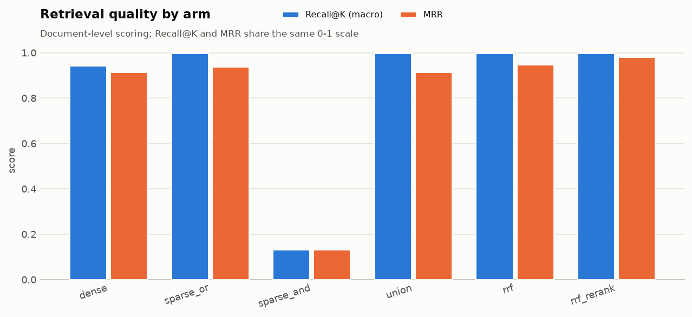
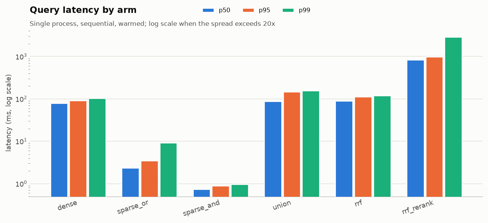
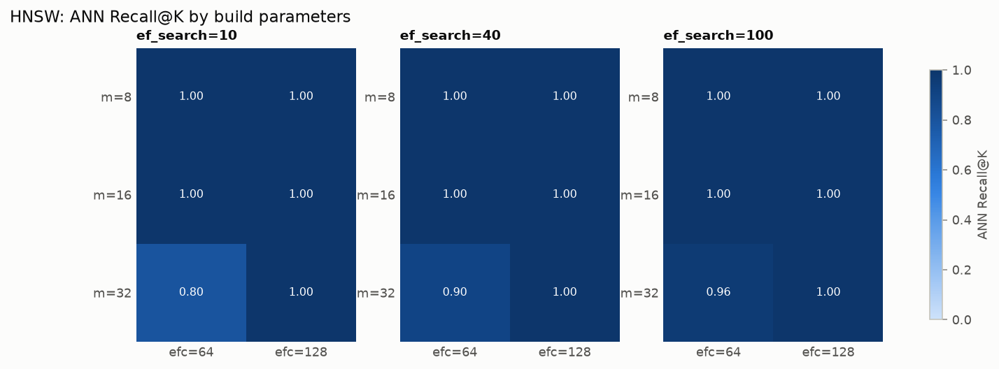
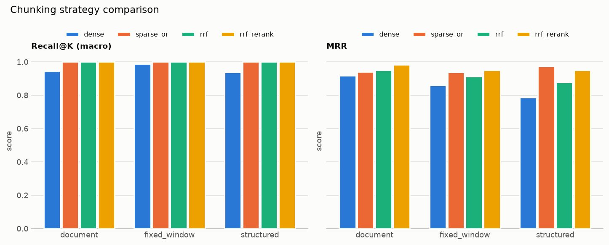
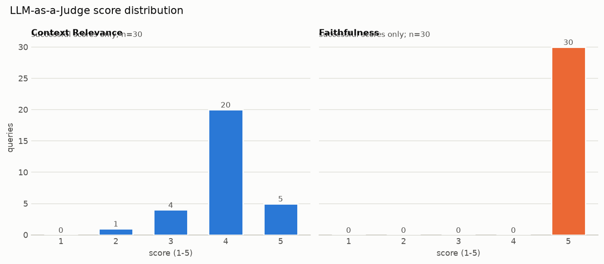

# 信用卡知识库 RAG 检索评测：最终报告

- 生成时间: 2026-10-20T06:41:15.425069+00:00
- Status: **PASS**
- Reason: all three artifacts are present and PASS

> 本报告只汇总已落盘的 artifact，不重算指标、不补历史数字。每个表格都标注了来源文件、SHA256 与字段路径。

## 1. 输入与可追溯性

| Artifact | Status | Generated | SHA256 | Path |
|---|---|---|---|---|
| benchmark | PASS | 2026-10-20T03:18:47.955795+00:00 | `366bf8f3767b10f0...` | `/app/reports/unified/benchmark.json` |
| index | PASS | 2026-10-20T04:04:26.002123+00:00 | `2bc1e260432b8e4b...` | `/app/reports/unified/index_benchmark_scale10.json` |
| chunking | PASS | 2026-10-20T03:24:39.510585+00:00 | `a06a04d362e0d1eb...` | `/app/reports/unified/chunking_benchmark_rerank.json` |

## 2. 数据与标注口径

- queries: 30 / on disk 30
- gold doc count: 38
- `kb_documents.json`: `7d230e97cbf76d2ca64382e7c0278c3b24bbe27b8a8904abc9553b45a230057d`
- `eval_queries.json`: `739bd308a90e72437ccbffca658ca950f6a069f2986040cb729694a878d9bbef`

- Gold 不是穷尽标注；非 gold 位置是未标注，不是 true negative。
- Precision@K 的分母固定为 K，并附 ceiling；只用于横向比较。
- 所有指标为文档级：同一文档的多个 chunk 先归并为一个排名。

## 3. 统一检索评测

> 来源: [artifact: /app/reports/unified/benchmark.json#arms[].metrics sha256=366bf8f3767b]

| Arm | Status | Recall macro | Recall micro | P@K | P@K ceiling | nDCG@K | MRR | Hit@1 | Evaluated | Source |
|---|---|---:|---:|---:|---:|---:|---:|---:|---:|---|
| dense | PASS | 0.9444 | 0.8837 | 0.1267 | 0.1433 | 0.9004 | 0.9167 | 25 | 30 | `benchmark#arms[0]` |
| sparse_or | PASS | 1.0000 | 1.0000 | 0.1433 | 0.1433 | 0.9506 | 0.9400 | 27 | 30 | `benchmark#arms[1]` |
| sparse_and | PASS | 0.1333 | 0.0930 | 0.0133 | 0.1433 | 0.1333 | 0.1333 | 4 | 30 | `benchmark#arms[2]` |
| union | PASS | 1.0000 | 1.0000 | 0.1433 | 0.1433 | 0.9383 | 0.9167 | 25 | 30 | `benchmark#arms[3]` |
| rrf | PASS | 1.0000 | 1.0000 | 0.1433 | 0.1433 | 0.9429 | 0.9500 | 27 | 30 | `benchmark#arms[4]` |
| rrf_rerank | PASS | 1.0000 | 1.0000 | 0.1433 | 0.1433 | 0.9777 | 0.9833 | 29 | 30 | `benchmark#arms[5]` |

> 延迟来源: [artifact: /app/reports/unified/benchmark.json#arms[].latency_ms.query sha256=366bf8f3767b]

| Arm | n | P50 ms | P95 ms | P99 ms | Max ms |
|---|---:|---:|---:|---:|---:|
| dense | 30 | 78.9038 | 92.5420 | 103.9207 | 103.9207 |
| sparse_or | 30 | 2.3820 | 3.5341 | 9.1987 | 9.1987 |
| sparse_and | 30 | 0.7433 | 0.9020 | 0.9652 | 0.9652 |
| union | 30 | 87.4786 | 146.8154 | 156.6699 | 156.6699 |
| rrf | 30 | 89.4952 | 111.8235 | 119.2112 | 119.2112 |
| rrf_rerank | 30 | 842.5759 | 999.0497 | 2920.4073 | 2920.4073 |

- 本次状态: **PASS** (all arms evaluated every expected query)

## 4. 索引参数实验

> 来源: [artifact: /app/reports/unified/index_benchmark_scale10.json#configurations[].query_params sha256=2bc1e260432b]
- Top-K: 10；查询数: 30；synthetic scale: 10
- 每个配置在临时表副本上重建索引；ANN Recall 相对精确 Seq Scan。
- synthetic scale > 1 时向量是确定性复制，只反映索引行为，不进入语义质量结论。

| m | ef_construction | ef_search=10 | ef_search=40 | ef_search=100 | Source |
|---:|---:|---:|---:|---:|---|
| 8 | 64 | 1.000 / 0.37 ms | 1.000 / 0.39 ms | 1.000 / 0.42 ms | `index#idx_bench_hnsw_m8_efc64` |
| 8 | 128 | 1.000 / 0.39 ms | 1.000 / 0.46 ms | 1.000 / 0.50 ms | `index#idx_bench_hnsw_m8_efc128` |
| 16 | 64 | 1.000 / 0.38 ms | 1.000 / 0.45 ms | 1.000 / 0.49 ms | `index#idx_bench_hnsw_m16_efc64` |
| 16 | 128 | 1.000 / 0.44 ms | 1.000 / 0.47 ms | 1.000 / 0.48 ms | `index#idx_bench_hnsw_m16_efc128` |
| 32 | 64 | 0.797 / 0.36 ms | 0.897 / 0.47 ms | 0.963 / 0.60 ms | `index#idx_bench_hnsw_m32_efc64` |
| 32 | 128 | 1.000 / 0.33 ms | 1.000 / 0.46 ms | 1.000 / 0.47 ms | `index#idx_bench_hnsw_m32_efc128` |

| lists | probes=1 | probes=2 | probes=4 | Source |
|---:|---:|---:|---:|---|
| 1 | 1.000 / 2.44 ms | 1.000 / 2.73 ms | 1.000 / 2.52 ms | `index#idx_bench_ivfflat_l1` |
| 2 | 0.967 / 2.08 ms | 1.000 / 2.27 ms | 1.000 / 2.23 ms | `index#idx_bench_ivfflat_l2` |
| 4 | 0.800 / 0.55 ms | 1.000 / 0.79 ms | 1.000 / 2.38 ms | `index#idx_bench_ivfflat_l4` |
| 8 | 0.800 / 0.51 ms | 0.833 / 0.62 ms | 0.967 / 0.87 ms | `index#idx_bench_ivfflat_l8` |
| 16 | 0.733 / 0.35 ms | 0.833 / 0.37 ms | 0.967 / 0.50 ms | `index#idx_bench_ivfflat_l16` |

- 本次状态: **PASS** (every index configuration completed)

## 5. 分块策略对比

> 来源: [artifact: /app/reports/unified/chunking_benchmark_rerank.json#summary[] sha256=a06a04d362e0]

| Strategy | Arm | Status | Recall macro | MRR | nDCG@K | P99 ms | Evaluated |
|---|---|---|---:|---:|---:|---:|---:|
| document | dense | PASS | 0.9444 | 0.9167 | 0.9004 | 135.9906 | 30 |
| document | sparse_or | PASS | 1.0000 | 0.9400 | 0.9506 | 4.1723 | 30 |
| document | rrf | PASS | 1.0000 | 0.9500 | 0.9429 | 99.6815 | 30 |
| document | rrf_rerank | PASS | 1.0000 | 0.9833 | 0.9777 | 2497.2251 | 30 |
| fixed_window | dense | PASS | 0.9889 | 0.8589 | 0.8731 | 92.3192 | 30 |
| fixed_window | sparse_or | PASS | 1.0000 | 0.9389 | 0.9448 | 4.0631 | 30 |
| fixed_window | rrf | PASS | 1.0000 | 0.9122 | 0.9247 | 111.4960 | 30 |
| fixed_window | rrf_rerank | PASS | 1.0000 | 0.9500 | 0.9607 | 711.2702 | 30 |
| structured | dense | PASS | 0.9389 | 0.7872 | 0.8129 | 191.4009 | 30 |
| structured | sparse_or | PASS | 1.0000 | 0.9733 | 0.9763 | 6.9236 | 30 |
| structured | rrf | PASS | 1.0000 | 0.8778 | 0.8992 | 132.9805 | 30 |
| structured | rrf_rerank | PASS | 1.0000 | 0.9500 | 0.9596 | 630.9877 | 30 |

| Strategy | Chunks | Documents | Avg chars |
|---|---:|---:|---:|
| document | 150 | 150 | 291.6 |
| fixed_window | 267 | 150 | 191.7 |
| structured | 161 | 150 | 133.0 |

- 本次状态: **PASS** (every strategy evaluated every expected query)

## 6. Cross-Encoder 精排

> 来源: [artifact: /app/reports/unified/rerank_20to5.json#arms[].metrics sha256=d0ececb9063d]
- 候选池 → 最终 Top-K: **20 → 5**；查询数: 30；RRF k: 60；chunk strategy: `document`
- 两个臂在同一批候选上实时执行：`rrf` 是融合排序基线，`rrf_rerank` 用 Cross-Encoder 重排候选池后截断到最终 Top-K。

| Arm | Status | Recall macro | Recall micro | nDCG@K | MRR | Hit@1 | Evaluated | Source |
|---|---|---:|---:|---:|---:|---:|---:|---|
| rrf | PASS | 0.9556 | 0.9070 | 0.9204 | 0.9500 | 27 | 30 | `rerank#arms[0]` |
| rrf_rerank | PASS | 1.0000 | 1.0000 | 0.9777 | 0.9833 | 29 | 30 | `rerank#arms[1]` |

> 延迟来源: [artifact: /app/reports/unified/rerank_20to5.json#arms[].latency_ms.query sha256=d0ececb9063d]

| Arm | n | P50 ms | P95 ms | P99 ms | Max ms |
|---|---:|---:|---:|---:|---:|
| rrf | 30 | 89.4622 | 109.5530 | 112.8697 | 112.8697 |
| rrf_rerank | 30 | 1790.9155 | 2038.5050 | 4683.3748 | 4683.3748 |

- 两个臂的候选池相同，因此 Recall 的差异只来自候选池构建，重排只应改变排序；跨策略比较不适用。
- 延迟包含 CPU Cross-Encoder 前向，单进程、顺序执行。
- 本次状态: **PASS** (all arms evaluated every expected query)

## 7. LLM-as-a-Judge

> 来源: [artifact: /app/reports/judge/judge_summary.json#summary.metrics sha256=9feefa14b934]
- Status: **PASS** (all queries were judged with a real judge on real RAG answers)
- 评判查询: **30 / 30**
- NOT RUN: **0**（未评分，未按 0 分计入）
- RAG provider: `real` / `openai_compatible` / model `deepseek-chat`
- Judge provider: `real` / `openai_compatible` / model `deepseek-chat`
- 同模型自评: **True**；真实 Judge 调用: **True**
- Prompt: `{'context_relevance': 'judge-context-relevance-v1', 'faithfulness': 'judge-faithfulness-v1'}`
- 均值/中位数/分布只使用 `status=success` 的评分；失败与未实际调用不计 0 分。

| Metric | Attempted | Success | Failed | Success rate | Valid n | Mean | Median | Low (< threshold) |
|---|---:|---:|---:|---:|---:|---:|---:|---:|
| Context Relevance | 30 | 30 | 0 | 1.0000 | 30 | 3.9667 | 4.0000 | 1 |
| Faithfulness | 30 | 30 | 0 | 1.0000 | 30 | 5.0000 | 5.0000 | 0 |

| Metric | 1 | 2 | 3 | 4 | 5 |
|---|---:|---:|---:|---:|---:|
| Context Relevance | 0 | 1 | 4 | 20 | 5 |
| Faithfulness | 0 | 0 | 0 | 0 | 30 |

低分样例：

| Query | Metric | Score | Reason |
|---|---|---:|---|
| Q-029 | context_relevance | 2 | The question asks specifically about Apex Preferred Travel's Global Entry/TSA PreCheck fee credits. Only E1 mentions a Global Entry/TSA PreCheck credit, but it applies to Apex Platinum, not Apex Preferred Travel. The remaining contexts concern Apex Preferred Travel but cover unrelated topics (credit |

限制：
- Judge scores are model-generated judgements, not ground truth; no human review or inter-judge agreement was performed.
- Context Relevance scores the supplied evidence only; it is not retrieval Recall and does not show that the right document was retrieved.
- Faithfulness uses only the evidence actually sent to the answer model. A claim that is true but absent from that evidence is still unsupported here.
- The judge may be sensitive to prompt order, context length and language; repeat-run variance was not measured.
- The 30 queries are English; Chinese and mixed-language judging are not evaluated.
- The judge reuses the same model id as the answer generator; self-evaluation bias is unquantified and the scores must not be treated as independent.
- Faithfulness 只使用本次实际进入生成上下文的 `evidence`；`gold_response` 参与评分: **False**。

## 8. 图表












## 9. 复现命令

```bash
python scripts/benchmark_all.py --overwrite
python scripts/benchmark_retrieval.py --arms rrf rrf_rerank --top-k 5 --candidate-k 20 --output reports/unified/rerank_20to5.json --report reports/unified/rerank_20to5.md
python scripts/evaluate_judge.py --rag-artifact reports/judge/rag_answers.json --judge-provider real
python scripts/report.py --benchmark /app/reports/unified/benchmark.json --index /app/reports/unified/index_benchmark_scale10.json --chunking /app/reports/unified/chunking_benchmark_rerank.json --rerank /app/reports/unified/rerank_20to5.json --judge /app/reports/judge/judge_summary.json
python -m pytest tests/test_report.py -q
```

## 10. 明确未验证的范围

- 生产级可用性、高可用、并发与容量规划均未验证。
- 10 万级以上规模的索引调优未验证；合成规模只反映索引行为。
- 真实 LLM 的答案正确性与 Answer Relevance 未评价；Context Relevance / Faithfulness 已执行 30/30 条（PASS），其分数是模型判断而非人工真值。
- 容器内外结果不等价；容器内验证以容器 artifact 为准。
- 中文语料与跨语言检索未单独验证。
